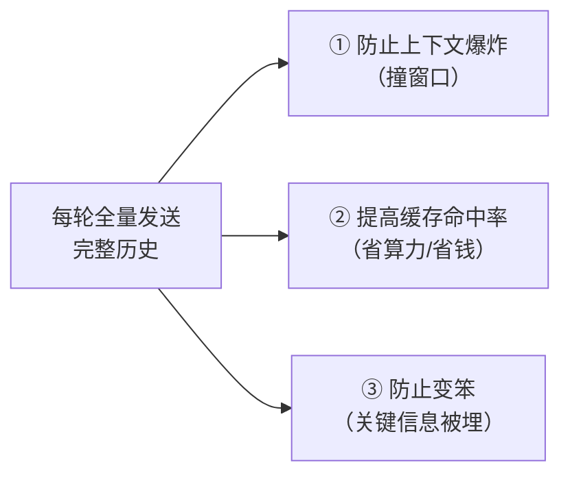
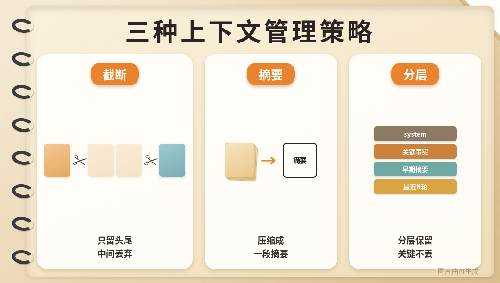

# 第 13 节 · 上下文管理：从"上下文"到 ContextManager

**上下文管理是 Agent 工程的核心命题。** 第 2 章 demo 里"每轮全量传 messages"看似没什么问题，但在真实任务中必然撞窗口——本节先搞清楚上下文到底是什么，再看它具体会出什么问题，然后给出截断 / 摘要 / 分层三种治理手段，最终落地成一个可复用的 `ContextManager` 类。


## 1. 什么是上下文：LLM 是无状态的

先问一个基础问题：**为什么 LLM 能跟你"连续对话"？**

答案可能和直觉相反：**LLM 本身是无状态的（stateless）**。每一次 API 调用都是独立的——模型不会在服务器那端"记得"你上一句说了什么，上一次调用结束，那次推理用到的所有中间状态就全部释放了。

能"连续对话"只是一种**客户端制造的假象**：每一次调用，客户端都把**从头到尾的完整历史**重新打包一遍，发给模型。这个"完整历史"就是**上下文（context）**，用代码表示就是那个越滚越大的 `messages` 列表：

```python
messages = [
    {"role": "system", "content": "你是个旅行助手。"},
    {"role": "user", "content": "我准备 6 月去北京玩 7 天。"},
    {"role": "assistant", "content": "好的，先问您几个问题……"},
    {"role": "user", "content": "我对花粉过敏。"},
    # ... 历史会一直追加下去
]

# 第 N 轮：把【迄今为止的全部历史】+ 这一轮新消息，原样重新发一遍
messages.append({"role": "user", "content": "那推荐几个景点吧"})
reply = llm.chat(messages)
messages.append({"role": "assistant", "content": reply})
```

模型看到的永远是这整个 `messages` 数组——它并不知道这是"第几轮对话"，只是在读一份完整的文本记录，然后续写下一段。**上下文窗口（context window）**就是这份记录能装多长的硬上限（比如 128K / 1M token），超过这个数字，模型直接读不进去。

这个"每轮都重发全部历史"的朴素实现，是第 2 章 demo 里就在用的方式，看起来没什么问题——直到对话变长。下一节就用一个实验把这个"看起来没问题"戳破。


## 2. 上下文会遇到的问题：实验"上下文爆炸"

跑一下 [`demo_13a_explosion.py`](../lab/demo_13a_explosion.py)，让 Agent 反复执行"总结之前的讨论 + 再补充 3 条建议"。每一轮都把【从第一轮开始的全部历史】原样重新发给模型，**真实 API 返回**的逐轮数据如下（具体数值每次运行会有波动，但趋势稳定）：

```text
轮次  messages 条数  prompt_tokens  本轮新增    缓存命中      命中率  total_tokens
----------------------------------------------------------------------------------
   1              4             57         -           0          0%           207
   2              6            235      +178           0          0%           385
   3              8            413      +178         256         62%           563
   5             12            769      +178         512         67%           919
  10             22          1,659      +178       1,408         85%         1,809
  15             32          2,549      +178       2,304         90%         2,699
  20             42          3,439      +178       3,200         93%         3,589

💡 第 1 轮 prompt = 57 tokens → 第 20 轮 prompt = 3,439 tokens，涨了 60 倍
   最后一轮缓存命中率 93%
```

**20 轮，prompt 从 57 涨到 3,439，翻了 60 倍**——而这还只是一个"反复总结"的简单任务，真实的多轮 Coding Agent 任务（夹带 `read_file`/`bash` 输出）涨得只会更快。但注意表格里还藏着第二条线索：**"缓存命中"这一列从第 3 轮起一路爬到 93%**——同样是"历史越堆越多"这件事，却同时带来了两种相反的后果。这正是本节要讲清楚的核心：**上下文工程不是解决一个问题，而是要同时搞定三个问题。**



- **① 防止上下文爆炸**：messages 列表只增不减，窗口再大也扛不住无限增长，Coding Agent 里的 `tool` 消息（工具返回结果）膨胀得尤其快。
- **② 提高缓存命中率**：每一轮都是"上一轮完整前缀 + 新增内容"，前缀不变就能被底层 KV Cache 复用，命中价格远低于标准价——但压缩会改写前缀，**等于主动打断缓存**，后面会用真实数据验证这个代价。
- **③ 防止变笨**：上下文越长，关键事实被埋在中间越容易被模型忽略，即便前两个问题都优化到位，这个问题依然可能让 Agent 答非所问。

> Andrej Karpathy 在 2024 年说过：**Context engineering is the new prompt engineering**。

换成大白话：在 Agent 时代，**写好 prompt 只是基本功**，真正的难点是**在正确的时机把正确的信息放进 messages**。具体来说，上下文工程覆盖四个维度：

- ContextManager → 管"本轮对话中 messages 怎么压缩，同时兼顾缓存命中率"（下面要产出的）
- Memory → 管"跨会话的事实怎么持久化 + 检索"（下一节）
- 工具的输出格式 → 管"tool 消息怎么写得短而有用"
- Skills（第 7 章） → 管"领域规范怎么按需加载"

下面要同时解决三个问题，而不是只压下 prompt_tokens 这一条曲线。


## 3. 治理上下文的几种方法：截断 / 摘要 / 分层



### 策略 ① 截断（Truncation）—— 解决防爆炸，不管防变笨

最粗暴也最常用的一招：**只留头和尾，中间全丢掉**。保留 system prompt + 最近 N 轮对话，其余历史消息一刀切，不分析、不总结、不纠结。

```python
def truncate(messages, keep_last=6):
    sys_msgs = [m for m in messages if m["role"] == "system"]
    recent = messages[-keep_last:]
    return sys_msgs + recent
```

| 优点 ✅ | 缺点 ❌ |
|---|---|
| 逻辑极简，10 行内搞定 | 早期重要信息（用户偏好、硬约束）过了 N 轮直接消失 |
| 零 LLM 额外调用，无额外成本 | 用户体感差："AI 怎么突然忘了我说过的话" |
| token 总量有硬上限，绝不会超预算 | 不仅丢事实，中间的多步推理链也一起没了 |

截断最适合**短对话场景**——客服问答、一次性脚本生成这类任务，关键上下文本来就在最近几轮里，丢了中间也不影响。

> [!WARNING]
>
> 新手最常踩的坑：`messages[-keep_last:]` 一刀切到底，把 system prompt 也砍了。没了角色约束，模型直接"放飞自我"。**结论：system 消息永远不参与截断，必须原样保留。**

### 策略 ② 摘要（Summary）—— 解决防爆炸 + 部分防变笨

比截断聪明一步：**不直接丢，而是压**。让 LLM 把中间的早期对话压缩成一段摘要，再拼上 system + 最近 N 轮原文。

```python
def summary(messages, keep_last=6):
    sys = [m for m in messages if m["role"] == "system"]
    middle = [m for m in messages if m["role"] != "system"][:-keep_last]
    recent = messages[-keep_last:]

    summary_text = llm.summarize(middle)  # ← 多花一次 LLM 调用，而且每次生成的文本都不同
    return sys + [{"role": "system", "content": f"[早期摘要]\n{summary_text}"}] + recent
```

**注意这里 `llm.summarize(middle)` 本身就是一次独立的 LLM 调用**——它不是主 Agent 循环里"回答用户问题"的那次调用，而是专门为了"把一段历史压成摘要"这一件事，临时发起的、职责单一的子调用。这种"一次性、无状态、只做一件窄域任务"的调用，业界有个专门的叫法——**Minion**（最轻量的子 Agent），本质上跟第 3 章 Planner/Aggregator"收窄职责的独立调用"是同一个套路，只是没有循环。

| 优点 ✅ | 缺点 ❌ |
|---|---|
| 信息保留度比截断好得多 | 多一次 LLM 调用（成本 + 延迟） |
| token 节省效果明显 | 摘要质量靠 LLM —— 关键事实可能被压成一句话 |
| | **每次调用都生成一段新文本，等于主动改写前缀**——下面会量化这个代价 |

> [!TIP]
>
> **让摘要更靠谱的两个 trick：**
>
> 1. 明确告诉 LLM 保留什么、丢掉什么：`"必须保留：用户偏好、硬约束、关键事实。可以丢弃：客套话、重复确认。"`
> 2. 让 LLM 输出结构化摘要（`- 用户偏好: ...` 这种分行列表），而非一段话，方便后续模型"按行查找"。

### 策略 ③ 分层（Hierarchical）

截断和摘要的缝合升级版：**中间的历史既不删也不压成一坨，而是分层对待**——每条信息按"距离当前任务的相关度"归入不同层级。

```text
[原始 system]            ← 角色定义 / 工具 / 规则（永不丢失）
[关键长期事实]            ← 用户的硬约束，单独抽出，跨轮持久化
[早期对话摘要]            ← LLM 压缩的中间对话
[最近 N 轮原文]           ← 保持原始精度
+ user 当前问题
```

**关键事实怎么找？** 最朴素的做法是关键词匹配——用户说"对了"、"一定要"、"重要"时，往往是在补硬约束：

```python
KEY_FACT_KEYWORDS = {"过敏", "预算", "重要", "对了", "一定要", "不要"}

def extract_key_facts_keyword(messages):
    return [
        m["content"].strip() for m in messages
        if m["role"] == "user" and any(kw in m["content"] for kw in KEY_FACT_KEYWORDS)
    ]
```

**但这是教学简化版，生产不会这么干。** 问题很致命：用户完全可能不说中任何关键词，比如"我吃辣一般，太辣的菜可能受不了"——明显是一条硬约束（忌口），但一个关键词都没命中，关键词版会直接漏掉它。真实生产做法是**再发起一次 Minion 调用做语义抽取**，让模型理解"这句话是不是在表达约束/偏好"，而不是做字符串匹配：

```python
FACT_EXTRACTION_PROMPT = """请阅读下面的多轮对话，找出其中用户透露的硬约束/偏好/关键事实
（例如：过敏、忌口、预算、时间限制、明确的喜好或厌恶）。
严格输出 JSON 数组，每项是一句精炼后的事实描述，没有就输出 []。

对话：
{transcript}

输出："""

def extract_key_facts_llm(messages):
    transcript = "\n".join(f"{m['role']}: {m['content']}" for m in messages if m["role"] == "user")
    raw = llm.chat(FACT_EXTRACTION_PROMPT.format(transcript=transcript))
    return json.loads(raw)   # 工程上通常用 structured output 强约束，这里简化展示
```

[`demo_13b_strategies.py`](../lab/demo_13b_strategies.py) 用真实数据对比了两者的输出（`run_extraction_comparison`），对同一段历史、同一句隐性约束"我吃辣一般，太辣的菜可能受不了"：

```text
关键词版抽取结果（extract_key_facts_keyword）：
  - 重要：我对花粉过敏，户外活动要避开花期。
  - 对了，我的预算是每天 500 元。

LLM 版抽取结果（extract_key_facts_llm）：
  - 6月去北京玩7天
  - 对花粉过敏，户外活动需避开花期
  - 不太能吃辣，点餐需注意避免太辣的菜
  - 每天预算500元
```

关键词版两条都命中了关键词表，但"吃辣"这条完全没出现——**漏得干干净净**；LLM 版理解了语义，四条全部抓到。这就是"看起来能用"和"真正好用"之间的真实差距。

| 优点 ✅ | 缺点 ❌ |
|---|---|
| **关键事实跨任意多轮也能保住**——这是分层最大的价值 | 实现复杂度比截断 / 摘要高一档 |
| 工程上很灵活：每一层独立可调 | 关键词版有天然盲区；LLM 版多一次调用（成本 + 延迟） |

分层最适合**多轮长对话**场景——用户会不断补充新约束，这种硬限制必须跨越所有工具调用一直保留。

### 真实验证"压缩税"：压缩会打断缓存前缀

前面讲过：压缩能防爆炸，但会打断缓存前缀。[`demo_13c_cache_tax.py`](../lab/demo_13c_cache_tax.py) 用真实 API 调用验证了这件事——跑一段"重复指令"对话，缓存命中率随轮数一路爬到 81%，在那之后主动触发一次摘要压缩，**下一轮命中率直接摔回 0%**，然后要重新从头爬升。省了窗口空间，代价是缓存清零重算。

> [!NOTE]
>
> **触发压缩应该是一个有成本意识的决策，不是消息数一多就无脑压**——这也是为什么下面的 `ContextManager` 要做"阈值触发"而不是"每轮触发"。


## 4. 产出：`ContextManager` 类

三种策略 + 缓存教训放在一起，最终收敛成一个类，统一处理三件事，而不是让它们互相打架：

```python
class ContextManager:
    def __init__(self, keep_last: int = 6, max_messages: int = 20):
        self._messages: list[dict] = []   # 状态自己持有，调用方不用来回传 messages
        self._keep_last = keep_last
        self._max_messages = max_messages
        self._last_compressed = False

    def _should_compress(self, messages: list[dict]) -> bool:
        """阈值触发，而不是每轮触发——避免把缓存命中率打成 0%。内部判断，
        外部不需要关心，也不应该自己调这个方法再决定要不要压。"""
        return len(messages) > self._max_messages

    def _compress(self, messages: list[dict]) -> list[dict]:
        """压缩这一下必须干好：分层策略 + LLM 事实抽取（而非关键词匹配），
        事实抽取器是可插拔参数，默认就用生产级的 extract_key_facts_llm。"""
        return strategy_hierarchical(
            messages, keep_last=self._keep_last, fact_extractor=extract_key_facts_llm
        )

    def add_messages(self, *new_messages: dict) -> None:
        """唯一的写入口：追加新消息，内部自动判断要不要压缩。"""
        self._messages.extend(new_messages)
        if self._should_compress(self._messages):
            self._last_compressed = True
            self._messages = self._compress(self._messages)
        else:
            self._last_compressed = False

    def messages(self) -> list[dict]:
        """唯一的读取口：拿到当前应该发给模型的 messages，纯读取，
        不触发任何副作用——压缩只在 `add_messages` 里发生。"""
        return list(self._messages)
```

对外只有两个方法：`add_messages()` 负责写入（内部自动决定要不要压缩），`messages()` 负责读取（纯读取，没有副作用）。`_should_compress`/`_compress` 是内部实现细节，加下划线表明"外部不要直接调"。这个设计比"传入 messages、再把处理后的 messages 传出去"更干净：`ContextManager` 自己持有状态，调用方不需要来回倒腾一份 messages 列表。

三个设计点，分别对应第 2 部分讲的三个问题：

| 设计点 | 对应问题 |
|---|---|
| `_should_compress` 用阈值而非"每轮都判断要不要压" | 防爆炸：到临界点才动手，不提前浪费 |
| `_compress` 内部用分层策略，不是简单截断 | 防变笨：关键事实单独抽出，不随摘要丢失 |
| 两次压缩之间 **append-only**、什么都不改写 | 提缓存命中率：前缀能稳定多久，缓存就能吃多久折扣 |

跑一遍 [`demo_13d_context_manager.py`](../lab/demo_13d_context_manager.py)，用这个类处理一段 30 轮历史，能看到它只在真正超过阈值（20 条）时才压缩，两个关键事实全程保住。

> [!TIP]
>
> 工业界比这更进一步：Claude Code 的压缩机制分两层——先尝试不调 LLM、只重排/淘汰工具结果（最便宜），撑不住了才触发一次 Minion 式压缩调用，输出结构化 digest；2026 年的 SelfCompact 研究则让模型自己判断"子任务是否已收敛"、安全时才压缩，而不是单纯数 token——同样的触发思路，比固定阈值节省 30%-70% 成本。本节的 `ContextManager` 是这类机制的最小教学版本，阈值判断可以按需升级成更智能的策略。


## 动手试试

在云原生开发环境中依次执行：

```bash
cd 04-context-and-memory/lab
python demo_13a_explosion.py        # 上下文爆炸实验
python demo_13b_strategies.py       # 三种压缩策略对比（截断/摘要/分层）
python demo_13c_cache_tax.py        # 真实验证压缩打断缓存命中率
python demo_13d_context_manager.py  # 产出 ContextManager 类
```

注意观察几件事：

1. `demo_13a`：prompt_tokens 从第 1 轮到第 20 轮涨了多少倍，缓存命中率又是怎么一路爬到 90% 以上的
2. `demo_13b`：哪种策略丢了"过敏"这条早期事实？关键词版和 LLM 版的事实抽取结果差在哪？
3. `demo_13c`：压缩发生的那一轮，缓存命中率摔到了多少？
4. `demo_13d`：`ContextManager` 在第几条消息触发了第一次压缩？压缩后两个关键事实还在吗？


## 核心回顾

| 要点 | 一句话理解 |
|------|---------|
| 上下文 | LLM 无状态，能连续对话全靠客户端每轮重发完整的 `messages` 历史 |
| 三个问题 | 防爆炸、提缓存命中率、防变笨——缺一不可，且互相牵制（压缩能防爆炸，但会打断缓存前缀） |
| ① 截断 | 防爆炸，但丢了早期事实（防变笨失败） |
| ② 摘要 | 防爆炸 + 部分防变笨，代价是多一次 LLM 调用且必然打断缓存 |
| ③ 分层（关键词/LLM 抽取） | 防爆炸 + 防变笨，关键词版有盲区，LLM 版生产级可靠但多一次调用 |
| `ContextManager` | 三个问题一起管：阈值触发 + 分层压缩 + append-only |
| Minion | 摘要/抽取这类"收窄职责的一次性调用"，是子 Agent 里最轻量的形态 |

一句话总结本节：**上下文管理不是"优化项"，而是一道需要在三个目标之间找平衡的工程题——截断和摘要各自只顾了一头，分层把"防爆炸"和"防变笨"接在一起，`ContextManager` 再把"提缓存命中率"也接进来，用一套统一的工程方案协调三个问题，而不是单独优化某一个。**


---

下一节：上下文管理是"本次对话的事"。但用户的偏好、约束、习惯——**这些应该跨会话存活**。这就是 Memory 系统。
