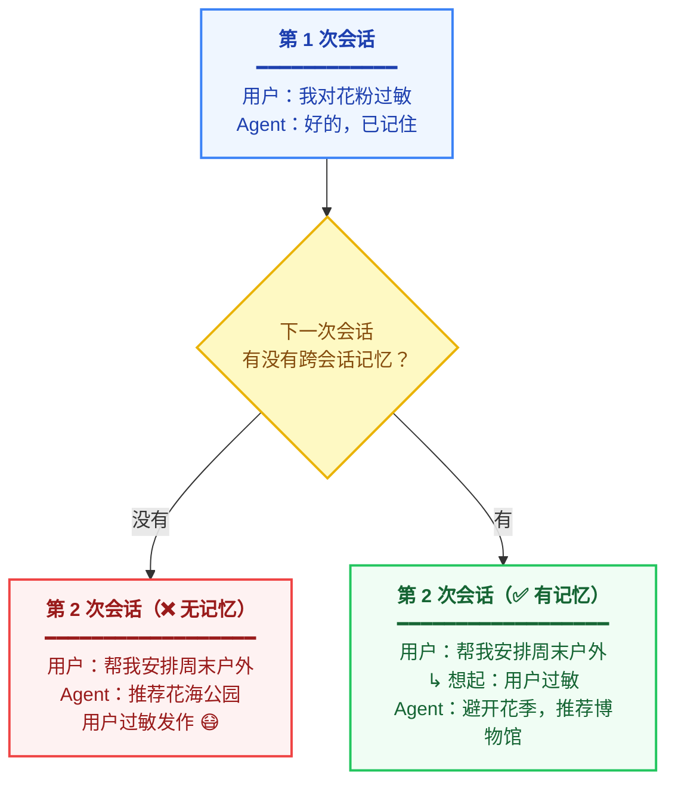
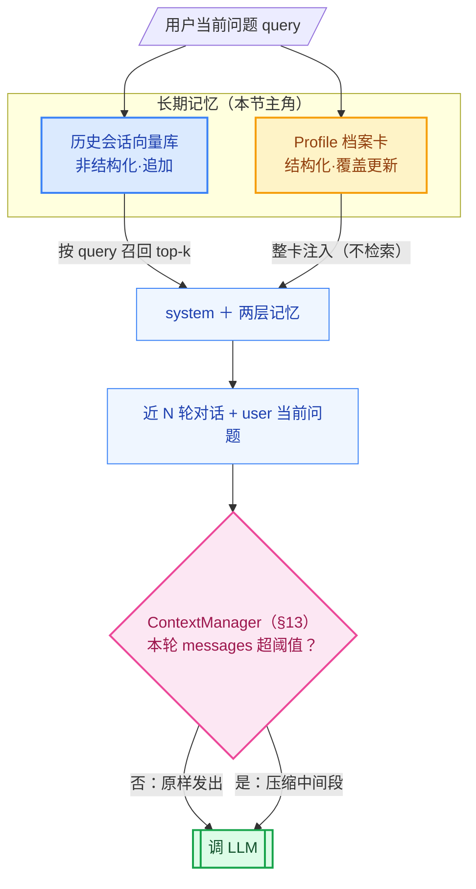

# 第 14 节 · 记忆系统：历史会话 + Profile 档案卡

**ContextManager 管"本次对话怎么压缩"（第 13 节），这一节管"跨会话怎么记住用户、并在下次用得上"。** 二者配合，Agent 才能既不爆窗、也不每次见面都失忆。

这一节我们不直接甩出"标准答案"，而是先顺着最自然的思路做一版，再看它在哪撞墙，被撞出来的需求会一步步把我们引到最终的两层结构。


## 一个问题：换个会话，Agent 就失忆了



第 13 节的 `messages` 列表只活在本次会话里，对话一结束就丢了。**没有跨会话记忆 = 每次会话都是「第一次见面」。**

那怎么办？最直接的想法是：**把聊过的东西存下来，下次需要时再捞回来。** 我们就从这个最朴素的方案开始做。


## 第一版：把历史会话存进向量库

用户跟 Agent 的每一次会话，结束后压成一条要点存起来；下次来了，用他当前的问题去"检索相关的往期会话"。这是最符合直觉的做法。

### 怎么存：每次会话压成一条摘要

不是把每一轮原文都塞进去（噪声多、库膨胀快），而是**一次会话 = 一条摘要**：会话结束用 LLM 压成一句要点，再存进库里。

```python
def add_session(self, messages):
    summary = llm.summarize(messages)      # 一次会话 → 一句要点
    self._store.append((summary, embed(summary)))   # 连同它的向量一起存
```

### 怎么取：用向量检索，而不是关键词

往期会话是自然语言、条数会一直涨，用户这次问"周末去哪"，要召回的可能是上次那条"因花粉过敏选了室内博物馆"——两句话没有一个共同的词。所以不能用关键词匹配，要用**语义**匹配：

| | 关键词检索（BM25 / TF-IDF） | 向量检索（embedding + 余弦） |
|---|---|---|
| 判断依据 | 词面重合：有几个相同的词 | 语义相近：向量空间里有多近 |
| 典型失败 | 查"健康限制"找不到"对花粉敏感"（零词面重合） | 同义、改写都能召回 |
| 代价 | 零成本、毫秒级 | 要调 embedding 接口 |

做法就是：把每条摘要和查询都编码成向量，算余弦相似度，取最接近的前 k 条。

```python
def search(self, query, k=3):
    q = embed(query)                                       # ① 查询也编码成向量
    scored = [(cosine(q, v), e) for e, v in self._store]   # ② 逐条算余弦相似度
    scored.sort(key=lambda x: x[0], reverse=True)          # ③ 按分数降序
    return scored[:k]                                      # ④ 取 top-k
```

### 别忘了持久化：这其实就是个最小本地 RAG

记忆是要**跨进程存活**的——Agent 重启、换个会话，历史会话库不能跟着清零。所以 `embed` 出来的向量要连同摘要一起**落盘**，下次直接加载，而不是每次重新 embed（embedding 有成本和延迟，重算几千条很浪费）。

```python
def save(self, path):   # 摘要 + 向量一起写进 JSON
    data = [{"summary": e.summary, "vec": e.vec.tolist()} for e in self._entries]
    json.dump(data, open(path, "w", encoding="utf-8"), ensure_ascii=False)

def load(self, path):   # 读回时 list 转回 ndarray，已有向量不必重算
    data = json.load(open(path, encoding="utf-8"))
    self._entries = [SessionEntry(d["summary"], np.array(d["vec"], "float32")) for d in data]
```

把这三件事连起来——**落盘保存 → 下次加载 → 向量召回**——就是一个麻雀虽小的本地 RAG：一个持久化的向量存储 + 一个语义检索接口。`demo_14a_history.py` 的第二个演示完整跑了这个闭环。生产上只是把这里的 JSON 换成 FAISS / Qdrant / pgvector，"存向量 + 按相似度查"的思路一模一样。

<details>
<summary><b>选读：Embedding 和余弦相似度的原理</b></summary>

**Embedding 模型**是一个专门把文本变向量的独立模型（不是 chat 模型，它不对话、只编码）：

```python
resp = client.embeddings.create(model="hunyuan-embedding", input="用户对花粉过敏")
vec = resp.data[0].embedding     # 一个定长 float 列表，长度约 1024 / 1536
```

这个向量就是高维空间里的一个点，**语义相近的句子，点也靠得近**。向量长度（维度）由模型写死：OpenAI `text-embedding-3-small` 是 1536，`text-embedding-3-large` 是 3072，混元 `hunyuan-embedding` 约 1024/1536。维度越高表达力越强，但每条向量越占空间、遍历越慢——这是量大之后要上专业向量库的原因。

**余弦相似度**衡量两个向量方向有多接近：

```python
def cosine(a, b):
    return float(np.dot(a, b) / (np.linalg.norm(a) * np.linalg.norm(b)))
```

它算的就是两向量夹角的 `cos(θ)`：点积定义 `a·b = |a||b|cos(θ)`，分母把长度约掉只剩方向；θ 从 0°→180°，`cos` 从 1（同向、最相似）单调降到 -1（反向）。embedding 的训练目标就是把语义近的句子映射到方向近的向量，所以"夹角小 ↔ cos 大 ↔ 语义近"。

```text
                 "用户对花粉过敏"
                         ↗  ← 夹角小，cos ≈ 0.8（相关）
   query:"周末有    ↗
   健康限制吗"   ●──────────→  "用户喜欢博物馆"
                              ↑ 夹角约 90°，cos ≈ 0.1（无关）
```

阈值 0.5 / 0.7 是经验值：完全无关的文本余弦通常落在 0.0~0.3，同主题约 0.5~0.75，近义改写 0.85+。**换 embedding 模型阈值会整体平移**，工程上要抽样校准。

</details>

到这里，"记住往期会话、按语义召回"已经能跑了。但如果 Agent 的记忆**只有这一层**，很快就会出事。


## 问题来了：只靠向量库，有两个硬伤

向量库擅长装"可能相关的往期上下文"，但有一类信息放进去就会出问题——**用户的稳定偏好、习惯，以及特定领域必须保持准确的关键事实**（比如"只用 TypeScript"、套餐等级、过敏源）。向量库的两个天性正好毁掉它们：

- **硬伤一·一致性**：召回是**概率性 top-k**，不是"所有该生效的事"。该一直生效的偏好，一旦和当前问题措辞不够近就漏召回，Agent 时而记得、时而忘记。
- **硬伤二·准确性**：向量库**只增不改**。用户把"预算 500"改成"预算 800"，两条会同时留在库里，Agent 分不清哪个有效，还越存越臃肿。

归纳一下，这类信息数量不多、天然是"字段 → 值"的结构，需要"每轮一致生效"且"随时可更新为最新值"——根本不适合丢进"概率召回 + 只增不改"的向量库。**把它们单独拎出来，做成一张结构化的档案卡。**


## 第二版：把稳定偏好与关键事实拎进 Profile 档案卡

Profile 就是一张"关于这个用户的结构化卡片"——每条信息落到一个**固定字段**上，而不是一段自由文本。字段集随 Agent 领域而定：个人助手可能是过敏/预算/城市，编程助手则可能是技术栈/代码风格/项目规范。

```python
from dataclasses import dataclass, field

@dataclass
class Profile:
    preferences: list[str] = field(default_factory=list)  # 偏好 / 习惯（多值）
    allergies: list[str] = field(default_factory=list)    # 过敏源（多值）
    dietary: list[str] = field(default_factory=list)      # 忌口（多值）
    budget: str = ""    # 预算（单值）
    city: str = ""      # 常驻城市（单值）
```

它正好一刀解决上面两个硬伤：

### 解决硬伤一：整卡注入，偏好每轮一致生效

档案卡很小，取用时**不检索、直接整张塞进 system**。于是偏好、习惯、领域关键事实**每一轮都在场**，不管用户当前问什么，个性化不再碰运气，也不会因措辞不匹配而漏掉领域事实。

```python
def profile_card(self):
    # → "- 过敏源：花粉、尘螨\n- 预算：每天 800 元\n- 常驻城市：北京朝阳"
    ...
```

### 解决硬伤二：覆盖合并，永远是最新值

每次会话结束，用一次 LLM 调用把对话抽成**上面这套 schema 的字段**（只抽这次提到的，是个增量），再由 Python 做合并。合并分两种语义：

```python
def commit_session(self, messages):
    delta = _extract_profile_fields(messages)   # LLM → 只含本次提到的字段

    # 单值字段：新值非空就覆盖（预算 500 → 800，旧值直接被替换）
    for f in ("budget", "city"):
        if delta.get(f):
            setattr(self, f, delta[f])

    # 多值字段：并集 + 去重（过敏源只增不丢，也不会重复）
    for f in ("allergies", "dietary", "preferences"):
        merged = dict.fromkeys(getattr(self, f) + delta.get(f, []))
        setattr(self, f, list(merged))
```

- 单值字段（预算、城市）：最新的**覆盖**旧的，不会出现"500"和"800"并存；
- 多值字段（过敏源、偏好）：`dict.fromkeys` 保序**并集去重**，重复说"对花粉过敏"也只留一条。

这就是结构化存储的红利——**天然免去重、天然可更新**，而这恰恰是向量库做不到的。

> [!NOTE]
>
> **为什么让 LLM 抽"字段"而不是抽"句子"？**
>
> 抽成固定字段，才能做"覆盖"——知道"800"要去替换 `budget`，而不是新增一条。
> 如果抽成自由句子（"用户预算 800"），就只能当新记录追加，又回到向量库那个老问题。
> 结构化的价值正是：**让"更新"成为可能，而不是只能"追加"。**


## 合起来：两层各管一类数据

走到这里，两层记忆是被"问题"一步步逼出来的，各自的边界也就清楚了：

| | 历史会话 | Profile 档案卡 |
|---|---|---|
| 存什么 | 说过的话：每次会话的要点 | 稳定的偏好 / 习惯 / 领域关键事实：偏好 / 过敏 / 预算 / 城市 / 技术栈… |
| 数据形态 | 大、**非结构化**、只增不减 | 小、**结构化**（固定字段，随领域而定） |
| 怎么更新 | **追加**（append-only） | **覆盖合并**（新值覆盖 / 并集去重） |
| 怎么取用 | **向量召回 top-k**，按需取 | **整卡注入**，每轮都在 |
| 要不要 embedding | 要 | **不要** |
| 适合装 | "可能相关"的往期上下文 | "该一直生效且保持最新"的偏好 / 习惯 / 领域数据 |

一句话主线：

> **检索策略要匹配数据形态**——非结构化的大数据才上向量（历史会话），结构化的小数据直接全塞（Profile）。不是所有记忆都该丢进向量库。

### 一次完整的"读 → 写"闭环



- **对话前（读）**：历史会话按问题召回 top-k + Profile 整卡注入，一起拼进 system；
- **对话后（写）**：历史会话追加一条本次会话摘要，Profile 覆盖更新档案卡；
- **ContextManager（第 13 节）**：只负责把"拼好的这一轮 messages"在超阈值时压缩，它不关心记忆从哪来——**Memory 决定塞什么进来，ContextManager 决定塞进来的怎么压**。

```python
# 对话前：两层各取各的，一起进 system
system = BASE + render(history.search(question, k=3)) + profile.profile_card()

# 对话后：两层各写各的
history.add_session(session)                # 追加一条摘要
profile.commit_session(session)   # 覆盖更新
```

> [!QUESTION]
>
> **留给你的思考题**：这里每轮都把 `history.search()` 召回的 top-k 记忆拼进 **system 的开头**，而 top-k 的内容是随当前问题变化的。回想第 13 节的前缀缓存三条规则——缓存只认"从头连续一致、位置也一致的前缀"。那么：**每轮都变的召回记忆放在 system 开头，会对 KV 缓存命中率造成什么影响？如果要尽量少破坏缓存，这两层记忆（Profile / 历史会话）分别该放在一轮 messages 的什么位置、以什么频率刷新？**


## 产出：`Memory` 类

上面那段"对话前拼 system、对话后各写各的"编排，如果每次都让调用方攥着 `history`、`profile` 两个对象手动来回倒腾，很容易写乱——忘了写哪一层、两层落盘不同步都是常见坑。和第 13 节把上下文治理收口成 `ContextManager` 对称，这里把"两层记忆怎么用"收口成一个门面类 `Memory`：

```python
from demo_14a_history import History, SessionEntry
from demo_14b_profile import Profile


class Memory:
    """两层长期记忆的统一门面：对外一个 Memory，对内 History + Profile 各司其职。"""

    def __init__(self, profile: Profile | None = None, history: History | None = None):
        self.profile = profile or Profile()
        self.history = history or History()

    # ---------- 读：对话前（接口刻意不统一） ----------
    def profile_card(self) -> str:
        """Profile 整卡渲染，没有 query——它该一直生效，不检索。"""
        return self.profile.profile_card()

    def search(self, query: str, k: int = 3) -> list[tuple[float, SessionEntry]]:
        """History 按问题语义召回 top-k——要检索。"""
        return self.history.search(query, k=k)

    # ---------- 写：预置 / 对话后 ----------
    def add_summary(self, summary: str) -> None:
        """直接追加一条历史摘要（预置往期记忆用）。"""
        self.history.add_summary(summary)

    def commit_session(self, messages: list[dict]) -> tuple[dict, str]:
        """会话结束时一次写回两层：Profile 覆盖更新 + History 追加一条摘要。"""
        delta = self.profile.commit_session(messages)
        summary = self.history.add_session(messages)
        return delta, summary

    # ---------- 持久化：两层一起 ----------
    def save(self) -> None:
        """一次 save 落盘两层：History 带向量、Profile 纯字段。"""
        self.history.save()
        self.profile.save()

    def load(self) -> None:
        """一次 load 还原两层。"""
        ...
```

`Memory` **不发明任何新机制**，它只收口两件最容易写乱的事——**写入时机**（两层都在"会话结束"那一刻写，于是 `commit_session()` 一次写完）和**持久化**（`save()`/`load()` 一次搞定两层，底层仍是 `history_store.json` 带向量、`profile_store.json` 纯字段两个文件）。

但要特别注意：**读取接口刻意不统一**，这正是本节主线，门面不该把它抹平——`profile_card()` 无 query、整卡注入（它该一直生效，不检索），`search(query, k)` 按问题召回 top-k（要检索）。两层数据形态不同，检索策略就必须不同，强行合成一个 `get()` 方法只会两边都做不好。完整可运行版本（含 `save/load` 细节、冷启动处理）见 [`demo_14c_memory.py`](../lab/demo_14c_memory.py)。

| 门面收口的事 | 为什么收口 |
|---|---|
| `commit_session()` 一次写两层 | 两层写入时机本就一致（会话结束），调用方不必记得"先更 Profile 再 add_session" |
| `save()` / `load()` 一次落盘/还原两层 | 避免两层持久化不同步 |
| 读取接口**不**统一（`profile_card` vs `search`） | 数据形态不同、检索策略就不同——这是本章主线，不能为了"看起来整齐"抹掉 |

到了下一节 `demo_15`，`AgentV2` = `ContextManager` + `Memory` 两个现成组件一拼即成：**Memory 决定塞什么进来，ContextManager 决定塞进来的怎么压**。


## 动手实践

```bash
cd 04-context-and-memory/lab
python demo_14a_history.py   # 第一版：历史会话向量库
python demo_14b_profile.py   # 第二版：Profile 档案卡 + 两层合起来
```

`demo_14a_history.py`（历史会话向量库）跑两个演示：**① 向量召回**——预置几条往期会话摘要，用不同问题做召回，看语义相近的被排到前面，并暴露"概率召回 + 只增不改"两个硬伤；**② 本地持久化**——把摘要+向量落盘成 JSON，再用一个全新实例加载、直接查询，走通"持久化 → 加载 → 召回"的最小本地 RAG 闭环。

`demo_14b_profile.py`（Profile + 两层合并）跑两个演示：

1. **Profile 覆盖更新**：第 1 次会话抽出预算 500、第 2 次会话说涨到 800——看档案卡里预算被覆盖（单值）、过敏源变成并集（多值），亲眼见证"天然去重 + 可更新"；
2. **两层注入对话**：历史会话 top-k + Profile 整卡一起塞进 system，真调一次 LLM，看回答是否同时体现往期上下文和稳定偏好。


## 要点回顾

| 概念 | 一句话理解 |
|------|-----------|
| 失忆问题 | `messages` 只活在本次会话，跨会话要靠长期记忆 |
| 历史会话（第一版） | 每次会话压一条摘要 → embed 入库 / 追加 / 向量召回 top-k |
| 向量库的两个硬伤 | 该一直生效的偏好时有时无（概率召回→一致性问题）、偏好变了没法更新（只增不改→准确性问题） |
| Profile 档案卡（解法） | 装稳定偏好/习惯/领域关键事实：固定字段 / 覆盖合并 / 整卡注入 / 零向量 / 天然免去重可更新 |
| 检索策略匹配数据形态 | 大而自由才上向量，小而结构化就全塞——不是所有记忆都丢向量库 |
| Embedding / 余弦 | 把文本变向量的独立模型；余弦衡量两向量方向多近，∈ [-1,1] |
| 和 ContextManager 的分工 | Memory 决定"塞什么进来"，ContextManager 决定"塞进来的怎么压" |


---

理论部分到此结束。下面 lab：
- Part 1：写 ContextManager（分层策略，第 13 节）
- Part 2：写 历史会话 + Profile 两层记忆
- Part 3：拼成 Agent v2，对比第 3 章朴素版的 token 消耗
